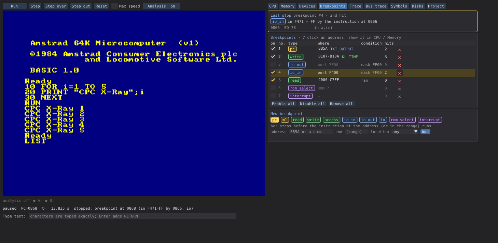

# CPC X-Ray

An Amstrad CPC 464 / 664 / 6128 emulator built for **reverse engineering**. It runs the real
firmware, BASIC, AMSDOS and any expansion ROM, lets you stop, step and inspect everything the
machine does, and turns the code you select - a ROM or a piece of RAM - into a documented,
reassemblable source. Claude Code can drive all of it through an MCP server.

> **Not a general-purpose emulator.** CPC X-Ray is not meant for playing games or running
> everyday CPC software - mature emulators exist for that. It is not built for speed (it runs
> at about real time, slower with the analysis and traces on) or for cycle-exact video tricks.
> It is built for **insight**: watching and analysing code at a depth that a CPC emulator has
> not offered before.



*The window: the running CPC on the left, the debugger on the right - here the Breakpoints tab
with breakpoints of several types (PC on the firmware's `TXT_OUTPUT`, a write to the variable
`KL_TIME`, I/O to the Gate Array and the keyboard port, a read of screen RAM, ROM select,
interrupt), their hit counts and the last stop.*

## What it is

The main use case: **disassembling and commenting existing CPC code** - a ROM, a game, a
utility - until you have a readable, documented source that assembles back to the original
bytes. And doing that **together with Claude Code**: through the MCP server Claude Code steers
and controls the whole machine - it boots it, types on it, inserts disks, sets breakpoints,
steps through the code, reads registers, memory and both traces, and runs the analysis. It sees
everything the machine does, so it can follow what the code really does at run time and help
you name routines and variables, write the comments and check the result.

CPC X-Ray is a CPC with the lid off. The machine is software compatible - the real ROMs boot to
BASIC, AMSDOS reads and writes disks, programs run as on the hardware - and every part of it
can be watched: each instruction, each memory and I/O access, each ROM switch. On top of that it
collects what it sees into an analysis of the code you are interested in - which bytes are
code, which are data, where code was copied and run - and that analysis becomes the source.

It was built to take apart ROMs whose code is **scrambled**: the Vortex X-module scheme encodes
opcode bytes and data bytes differently, so a ROM dump alone cannot be disassembled. CPC X-Ray
decodes such a ROM on every access, depending on whether the CPU fetches an opcode (M1) or reads
data, and records which byte was read how. The same tools work for any ordinary ROM or RAM
program.

## What it can do

**The machine**
- CPC 464, 664 and 6128 (with 128 KB RAM banking), configured in a `machine.toml`; the
  standard Amstrad ROMs come with it, your own ROMs go into `roms/`.
- A Z80 core written from scratch that behaves exactly like the real CPU towards software -
  documented and undocumented behaviour, every bus access in the real order - verified with
  1.6 million single-instruction tests, ZEXALL and z80test.
- Gate Array, CRTC, ROM select, keyboard and the µPD765 floppy controller with two drives:
  3" disks (DSK, EDSK) in A:, 80-track disks in B:. Real disk images are inserted read-only.
- Real-time display, and your PC keyboard types on the CPC by character, whatever your layout.

**The debugger**
- Run, step, step over, step out, run to an address; every run is bounded and reports why it
  stopped.
- Breakpoints of ten types - PC, M1, memory read / write / access, I/O in / out, ROM select,
  interrupt - with ranges, port masks and conditions on what is paged in (a ROM, a RAM block).
- Memory views of the CPU, RAM blocks, ROM images and decoded ROMs, coloured by the known
  firmware and AMSDOS variables; the paging of each 16 KB quarter; the stack; the devices'
  state; `.sna` snapshots.
- Firmware names for all three machines, your own labels, comments, comment blocks above and
  below a line, and variables; groups for programs that use the same RAM differently (code
  contexts decide which name an address gets); you decide whether an operand is a number or
  an address.


*The CPU tab, stopped inside the firmware's text output: registers (main and alternate, changed
ones in yellow) and flags, what is paged into each 16 KB quarter, the disassembly with firmware
names (blue) and variables (green), and the stack from SP up to its top - the return address
&1407 of `call TXT_OUT_ACTION` above the four pushed registers, and the `ld sp` that set the
top.*

**Tracing: what ran, and what happened on the bus**
- The **instruction trace** records every executed instruction with its bytes, the registers
  before it, where it ran (lower ROM, ROM n or RAM - and for code copied to RAM, the ROM it came
  from) and calls and returns. After a stop you can go back through the history and see how the
  program got there; steps are always recorded. Limit it to an address range or to the code
  under analysis, and write it to a file as text, CSV or JSON Lines.
- The **bus trace** records every bus access - opcode fetches (M1), memory reads and writes,
  I/O in and out, interrupt acknowledges - with the instruction that made it, in a ring buffer
  of up to a million accesses. Browse anywhere in its history, grouped per instruction and
  explained: the variable a read or write touched, a return address pushed or popped, the
  device a port belongs to and what the value does there.
- For a stepped instruction you see exactly what it read and wrote; "Follow CPU" shows what
  was written to memory since the last stop.


*Back in time: the Trace tab after stepping into the firmware's `TXT_OUTPUT`. The instructions
are indented by call depth (▸ call, ◂ return), a separator marks each move between the lower
ROM and RAM, firmware names and variables are coloured, and each line shows the registers it
changed. The selected `call TXT_OUT_ACTION`, 26 instructions back, shows its two stack writes
and the registers before and after.*

**The analysis**
- Analysis targets: any ROM or RAM range. The run collects instruction starts, code copied to
  RAM and run there, relocated blocks, RST calls with inline data and far addresses.
- Scrambled ROMs: the decoded image, the access map (which byte was read as opcode, as data,
  both or never), conflicts, a ROM map (HTML / text) and coverage figures.
- A classifier that turns these facts into code and data, and a source generator that writes
  an **sjasmplus source**, with firmware names, variables and your labels. A round-trip check
  assembles it and compares it with the original byte for byte.
- The Project tab leads through the five phases: collect, decode, save, generate, verify.

**Claude Code and automation**
- Every function is one **MCP tool** (99 of them): Claude Code can boot the machine, type,
  set breakpoints, read memory and traces, and run the analysis - headless or attached to the
  open window.
- A command line for the window, the MCP server, checking a configuration and the round trip.

## Documentation

- [Install guide](docs/install.md) - downloading a release, the project folder, first start
- [User guide](docs/user_guide.md) - the window and its tabs, a typical analysis session from
  collecting to the verified source, file formats, troubleshooting
- [Command line](docs/cli.md) - every command and option, its output and exit codes
- [MCP reference](docs/mcp.md) - the MCP server and all its tools, grouped by task
- [Claude Code with cpcxray](docs/claude_code.md) - connecting Claude Code (headless or to the
  window) and working with it
- [Developer guide](docs/developer_guide.md) - how cpcxray is built, the path of one
  instruction through the code, where each part lives, tests and conventions
- [Architecture](docs/architecture.md) - the session layer, the machine and the Z80 core as
  block diagrams, with what each layer does and how the CPU model relates to the real chip

## Install

Each release on the [releases page](https://github.com/SerErris/cpcxray/releases) offers:

- **The Python package** (`cpcxray-<version>-py3-none-any.whl`), for any system with
  Python 3.12 or newer. With [pipx](https://pipx.pypa.io):

  ```bash
  pipx install "cpcxray[gui,mcp] @ https://github.com/SerErris/cpcxray/releases/download/v0.9.3/cpcxray-0.9.3-py3-none-any.whl"
  ```

- **A ready-made program** for Linux (`…-linux-x86_64.tar.gz`) or Windows
  (`…-windows-x86_64.zip`), no Python needed: unpack it and run `cpcxray` (`cpcxray.exe`) in
  the unpacked folder - it is a project folder already.

## Start

```bash
cpcxray init my_cpc        # a project folder: configs, the standard ROMs, disk/, project/, output/
cd my_cpc
cpcxray gui                # the CPC 464 boots to BASIC
cpcxray gui --config config/cpc6128.toml   # or the 664 / 6128
```

The standard Amstrad ROMs (OS, BASIC, AMSDOS of the 464, 664 and 6128) come with cpcxray. Put
other ROMs into `roms/` and disk images into `disk/`; the Project tab's machine editor adds
them to the configuration. `cpcxray config` checks a configuration.

Type on your own keyboard layout: the character you type is typed on the CPC.

## Claude Code (MCP)

- Headless: add to the project's `.mcp.json`: `{"mcpServers": {"cpcxray": {"command":
  "cpcxray", "args": ["mcp"]}}}`.
- Attach to the running window: `claude mcp add --transport http cpcxray-gui
  http://127.0.0.1:8765/mcp`.

## Requirements

- [sjasmplus](https://github.com/z00m128/sjasmplus) on the PATH, only for the round-trip check
  of generated sources (`cpcxray source-verify`, the Verify phase).
- The window uses OpenGL (Dear PyGui); under WSL it runs with WSLg.

## Licence

GPL-3.0-or-later (see `LICENSE`). Third-party parts (the Amstrad ROMs, the DejaVu font):
see `THIRD_PARTY.md`.
