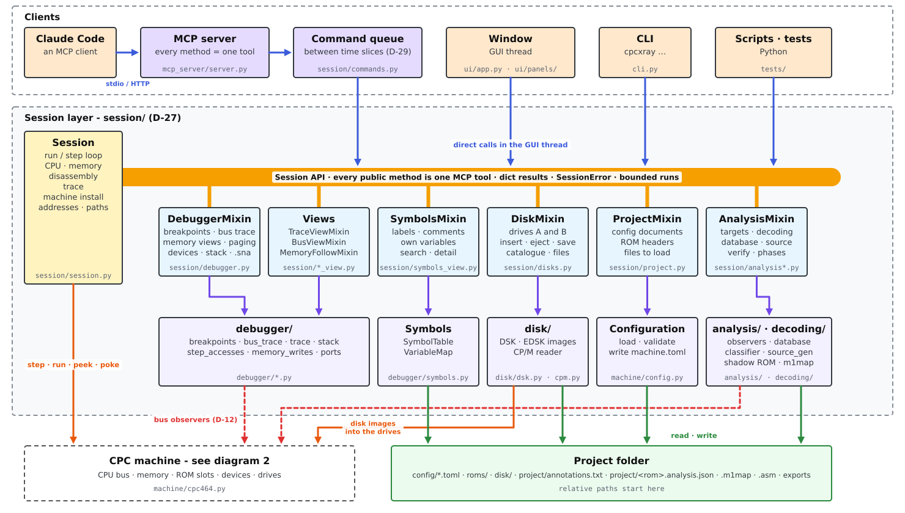
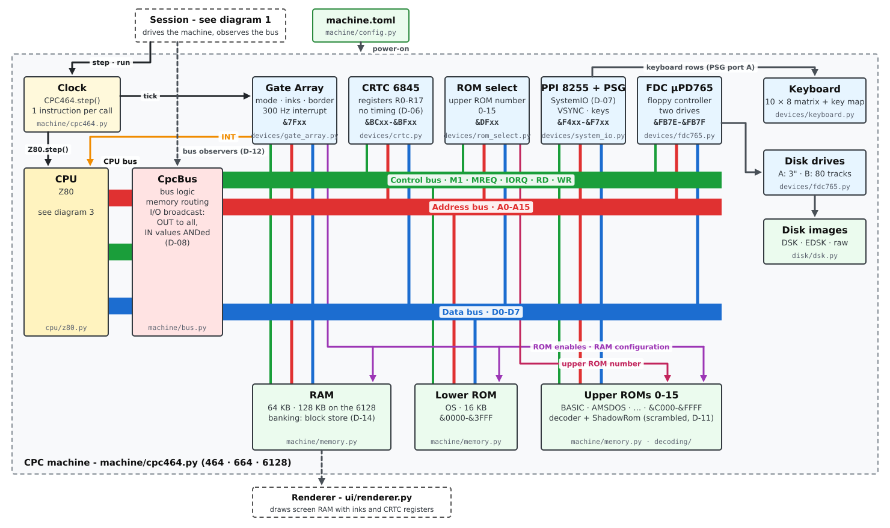
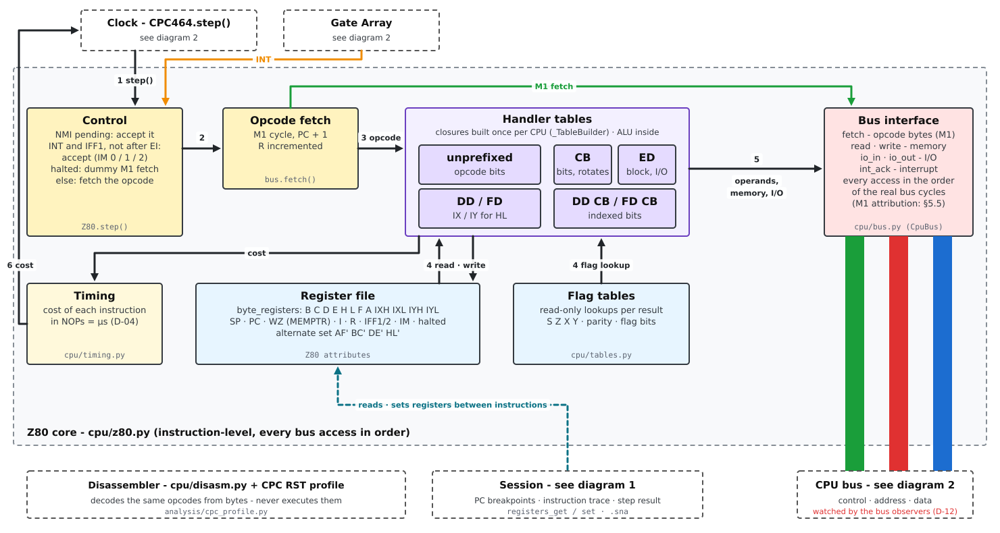

# CPC X-Ray developer guide

This guide is the map of the code base: how cpcxray is built, how a machine instruction travels
through it, where each part lives and how to extend it. It explains; it does not decide. The
decisions (D-01…D-41), requirements (FR-…, NFR-…) and the architecture in full are in
[design.md](design.md), which is authoritative - code comments cite its IDs (`# D-11`). The
three block diagrams of session, machine and Z80 core with their legends are in
[architecture.md](architecture.md). Using the tool: [user guide](user_guide.md), [CLI](cli.md),
[MCP reference](mcp.md).

Contents: [1 Setup](#1-development-setup) · [2 Architecture](#2-architecture-at-a-glance) ·
[3 One instruction](#3-the-journey-of-one-instruction) · [4 Packages](#4-the-packages) ·
[5 Session](#5-the-session-api) · [6 GUI](#6-the-gui) · [7 Analysis](#7-the-analysis-pipeline) ·
[8 Generated data](#8-generated-data-and-reference-documents) · [9 Tests](#9-tests) ·
[10 Conventions](#10-conventions) · [11 How to…](#11-how-to) · [12 Release](#12-release) ·
[13 Where to look](#13-where-to-look)

---

## 1. Development setup

```bash
git clone https://github.com/SerErris/cpcxray.git && cd cpcxray
python3.12 -m venv .venv && source .venv/bin/activate
pip install -e ".[dev]"            # editable, with pytest, ruff, pylint, mcp, dearpygui, numpy
```

| Command | Purpose |
|---|---|
| `pytest` | the test suite (~2 min; `slow` tests excluded) |
| `pytest -m slow` | the complete CPU validation runs (ZEXDOC/ZEXALL, z80test; long) |
| `ruff check` / `ruff format` | lint / format (Markdown is excluded) |
| `pylint src tests tools` | must rate 10/10 |
| `cpcxray gui` | the window, from the repository (it is a project folder: `config/`, `roms/`, …) |

- **sjasmplus** must be on the PATH (the round-trip check; `tests/test_tools.py` checks it).
- **External CPU test data** (not in git, pinned by SHA-256) go to `tests/data/external/`:
  `tools/fetch_test_data.sh`. Tests that need them skip without.
- **GUI tests** open a real window (WSLg under WSL); they skip without a display.
- The repository's `roms/` holds your local ROMs (git-ignored); the seven standard ROMs are in
  `src/cpcxray/roms/` (package data, in git). `disk/` (your images), `project/`, `output/` are
  git-ignored.

## 2. Architecture at a glance



The session layer: the clients call the Session API, its mixins use the services, and the
Session drives the machine below (diagram 2 in section 3). Line colours:
[architecture.md](architecture.md#1-the-session-layer).

- **Layers point down.** The CPU knows only its `CpuBus` protocol; the machine knows nothing of
  debugging; debugger and analysis attach to the machine as **bus observers**; the session ties
  everything together; GUI and MCP server are thin clients of the session.
- **One API.** Every public `Session` method is an MCP tool with the same name and parameters
  (generated, D-27); the GUI calls the same methods. A feature exists once.
- **Single-threaded emulation** (D-13): the machine runs in time slices in one thread; other
  threads (the MCP server) hand in commands through a queue (D-29).
- **Instruction-level, software compatible** (not cycle-exact): each instruction costs whole
  "NOPs" (1 µs, D-04); interrupts, VSYNC and devices follow simplified models (D-05…D-07).

## 3. The journey of one instruction

Following one instruction shows how the parts connect (`Session.run` in session/session.py).
The machine: the clock (`CPC464.step`) runs the Z80, which reaches memory and devices only
through the CPU bus and `CpcBus`:



Inside `Z80.step` - the numbered arrows are steps 1-6 of one instruction:



Legends and the steps in words: [architecture.md](architecture.md#2-the-machine).


1. **`Session._run_loop`** checks before each instruction: the target address (`run_until`), PC
   breakpoints (`_pc_breakpoint`: a set lookup, stops *before* the instruction), the limits
   (instructions, emulated time, wall clock, `pause`). With the trace on, it captures the
   instruction's bytes and registers (`_trace_instruction`; disassembled only when read).
2. **`CPC464.step`** (machine/cpc464.py) sets the CPU's INT line from the Gate Array, tells the
   bus and the shadow ROMs the instruction's PC, calls `Z80.step`, adds the cost to the clock,
   ticks the Gate Array (300 Hz interrupt, VSYNC) and the keyboard's typing schedule.
3. **`Z80.step`** (cpu/z80.py) fetches the opcode with `bus.fetch` (an M1 cycle), decodes it
   through handler tables built per CPU instance from the opcode bit fields, and does its
   reads, writes and I/O through `bus.read` / `bus.write` / `bus.io_in` / `bus.io_out` - in
   the order of the real bus cycles - and returns its cost from cpu/timing.py.
4. **`CpcBus`** (machine/bus.py) routes memory accesses to the **`MemoryMap`**
   (machine/memory.py): ROM or RAM by the Gate Array's ROM enables and the selected upper ROM;
   writes always go to RAM; the 6128 banks RAM by swapping pages (D-14). A **`RomSlot`** with
   a decoder returns M1 fetches raw and decodes data reads (D-11) and records every read in its
   **`ShadowRom`** (decoding/shadow_rom.py: the access map). I/O is **broadcast** (D-08): every
   device decodes its own port bits; IN values are ANDed.
5. **Bus observers** see the accesses they asked for: breakpoints (debugger/breakpoints.py),
   the bus trace, Follow CPU's write observer, step accesses, and the analysis observers
   (analysis/provenance.py, analysis/observers.py). They are opt-in (D-12): while nobody
   watches a kind of access, the bus uses its plain fast method; registering an observer swaps
   in the observed variant only for the kinds it declares (`handlers`).
6. Back in the run loop: an access breakpoint that fired stops the run *after* the instruction
   (`_access_breakpoint`), with the access, address, value, PC and the variable it touched.

The screen is not emulated by the CPU loop: **ui/renderer.py** draws a snapshot of screen RAM,
palette and CRTC registers per GUI frame.

## 4. The packages

All code is in `src/cpcxray/`. Each module starts with a docstring that explains it; read that
first.

### cpu/ - the Z80

| Module | Contents |
|---|---|
| `z80.py` | the core: registers (`byte_registers`, named properties), handler factories per opcode group (`group`, `bits_5_3`, `bits_2_0`), DD/FD via the same factories with IX/IY, interrupts, MEMPTR (WZ). Building a `Z80` creates ~2000 closures: reuse instances. |
| `timing.py` | cost of every instruction in CPC NOPs (D-04) |
| `tables.py` | flag lookup tables |
| `bus.py` | the `CpuBus` protocol, `Cycle` kinds, a flat 64 KB bus for tests |
| `disasm.py` | the disassembler: sjasmplus syntax, a profile for RST conventions (D-30), non-canonical encodings flagged (D-32) |

### machine/ - the CPC

| Module | Contents |
|---|---|
| `cpc464.py` | `CPC464` (all three models): wiring, power-on, `reset`, `step`, ROM install, `skipped_roms`, `key_map()` |
| `memory.py` | `MemoryMap` (`ram` = the CPU's 64 KB view, block store for the 6128), `RomSlot` (decoder, `ShadowRom`) |
| `bus.py` | `CpcBus`: memory routing, I/O broadcast, observer method swapping |
| `config.py` | `machine.toml`: `load_config` / `parse_config` (strict validation), `MachineConfig` dataclasses, writing (`config_data`, `format_config`, `save_config`) |
| `flat.py` | the `Machine` protocol the session needs, and `FlatMachine` (bare Z80) |
| `screen.py` | screen memory layout, `screen_text` (characters by the ROM font) |
| `sna.py` | `.sna` load (v1-v3) and save (v3) |

### devices/ - I/O

`gate_array.py` (mode, pens, inks, ROM enables, interrupt timer, 6128 RAM configuration),
`crtc.py` (register file only, D-06), `rom_select.py`, `system_io.py` (PPI + PSG replacement:
keyboard port, VSYNC bit, D-07), `keyboard.py` (the 10 × 8 matrix, key sources "api" / "host" /
"typing", timed typing), `key_map.py` (key names and the firmware's translation tables read from
the OS ROM), `fdc765.py` (µPD765 with two drives).

### disk/ - disk images

`dsk.py` (`DiskImage`: DSK, EDSK, raw Vortex images; blank formats) and `cpm.py` (a host-side
CP/M reader: directory, files, AMSDOS header - no emulation).

### decoding/ - scrambled ROMs

`vortex.py` (the XOR rule, `DECODERS`), `shadow_rom.py` (per byte: access class, clear value,
first PC, hits; conflicts), `m1map.py` (`.m1map` files, decoding from a map, fill policies),
`export.py` (clear dump, ROM map HTML / text, coverage CSV).

### analysis/ - understanding the code

`targets.py` (ROM / RAM targets and their per-byte flags), `provenance.py` (RAM tags, relocated
blocks, RAM-target capture), `observers.py` (instruction starts, RST operands, far addresses),
`database.py` (`TargetDatabase`: kind + source per byte, observations, owner overrides),
`classifier.py` (rebuilds the kinds from the facts; `TargetView`), `cpc_profile.py` (the CPC RST
profile), `operands.py` (is an immediate an address?), `source_gen.py` (the sjasmplus source),
`verify.py` (round trip). See section 7.

### debugger/ - debugging services

`breakpoints.py` (all kinds, location qualifiers, the observer), `bus_trace.py` (ring buffer),
`trace.py` (instruction trace, sinks), `step_accesses.py`, `memory_writes.py` (Follow CPU),
`stack.py` (stack tops from SP loads, D-36), `ports.py` (meaning of I/O accesses),
`symbols.py` (`SymbolTable`: owner and firmware layers, types, own variables, annotation file),
`variables.py` (`VariableMap`: OS / AMSDOS / own variables resolved on the running machine),
`firmware_symbols.py` and `variable_tables.py` (generated, section 8).

### session/ - the Session API

See section 5.

### mcp_server/ - the MCP server

`server.py` turns every public `Session` method into a tool (name, parameters with JSON schema,
docstring as description), runs it through the command queue, and serves stdio or streamable
HTTP. Nothing to change when you add a session method.

### ui/ - the window

See section 6.

### Other modules

`cli.py` (the `cpcxray` command, docs/cli.md), `project_init.py` (`cpcxray init`), and the
package data `templates/`, `roms/`, `fonts/`.

## 5. The Session API

`Session` (session/session.py) owns the machine, the debugger state and the analysis state, and
is the only way to act on them (D-27). It is assembled from mixins, one per tool group:

| Module | Mixin | Tools / responsibility |
|---|---|---|
| `session.py` | `Session` | machine, run / step loop, CPU, memory, disassembly, trace, `_install_machine`, helpers (`_address`, `_path`, `_label`) |
| `debugger.py` | `DebuggerMixin` | breakpoints, bus trace, memory views, paging, devices, stack, last stop, `.sna`; shared helpers for operand names and code rows |
| `trace_view.py` | `TraceViewMixin` | `trace_records`, step accesses, gap records |
| `memory_follow.py` | `MemoryFollowMixin` | `memory_follow`, `memory_changes_get` |
| `bus_view.py` | `BusViewMixin` | `bus_trace_view`, `bus_trace_clear` |
| `symbols_view.py` | `SymbolsMixin` | symbols, own variables, `symbol_search`, annotation file |
| `disks.py` | `DiskMixin` | drives and images |
| `project.py` | `ProjectMixin` | configuration documents, `rom_header`, files to load |
| `analysis.py` | `AnalysisMixin` | scrambled ROMs, targets, relocations, database, source, verify |
| `analysis_view.py` | `AnalysisViewMixin` | `analysis_status` (the Project tab's phases) |
| `commands.py` | `CommandQueue`, `SessionClient`, `SessionWorker` | the thread boundary (D-29) |
| `errors.py` | `SessionError` | the error clients see |

Rules for session methods (they are MCP tools):

- **Public method = tool.** Name and signature are the tool's; the docstring is its description
  (and the MCP reference, docs/mcp.md). Private helpers start with `_`.
- **Return a dict** (JSON-compatible; a list would become several MCP content blocks).
- **Raise `SessionError`** for bad requests; the message reaches the client.
- **Accept addresses** as int, hex string or name (`self._address(value)`); return 4-digit hex.
- **Bound everything**: runs have limits and a wall-clock timeout; large results are capped
  (FR-MCP-04/05).
- **Paths** are relative to `self.project_dir` (`self._path(path)`).

Mixins declare the attributes and helpers they use from `Session` as stubs; a mixin's stub must
not shadow a real method earlier in the MRO (the order of `Session`'s bases matters).

**Threads.** Headless, a `SessionWorker` thread owns the session and executes queued commands;
the MCP server's handlers go through a `SessionClient`. In the GUI, the GUI thread owns the
session and `EmulationLoop.frame()` runs the queued commands between time slices. Only
`pause()` bypasses the queue (it sets an event the run loop polls).

## 6. The GUI

| Module | Contents |
|---|---|
| `ui/app.py` | `App`: the Dear PyGui window (screen texture, tool bar, status line, "Type text", the hidden character inputs), the per-frame loop (`render_frame`), MCP over HTTP in GUI mode |
| `ui/emulation.py` | `EmulationLoop`: per frame the queued commands, then a real-time (or max-speed) slice; stops on breakpoints; no Dear PyGui (tested headless) |
| `ui/renderer.py`, `ui/palette.py`, `ui/png.py` | snapshot → RGBA (numpy), CPC colours, PNG for `screen_image` |
| `ui/host_keys.py` | the PC keyboard by character (D-40): `CharacterInput`, `HostKeyboard` (headless logic) |
| `ui/panels/tabs.py` | `DebuggerPanels`: the tab bar, refresh scheduling, list keys, "keys belong to the panels" |
| `ui/panels/base.py` | `Tab` (build / refresh / call), `PanelContext` (session, loop, styles, one `items` dict for all tabs) |
| `ui/panels/widgets.py`, `colours.py` | `Styles` (themes), sections, badges, chips, path fields, separators; the colour table |
| `ui/panels/scroll_list.py`, `file_selector.py` | the scroll list (`ListState` headless) and the file dialog |
| `ui/panels/<tab>.py` | one module per tab: cpu, memory, devices, breakpoints, trace, bus_trace, symbols, disks, project (+ `analysis_phases.py`) |
| `ui/panels/text.py`, `symbol_text.py`, `project_text.py` | all formatting and parsing without Dear PyGui - tested headless |

How the panels work:

- A tab builds its widgets once (`build`) and fills them from session calls (`refresh`).
  Actions go through `Tab.call`, which reports errors in the tab's message line and refreshes
  all tabs.
- **Refresh rules** (D-39): panels refresh while the machine is stopped (the visible tab every
  5th frame); while it runs they are frozen, except tabs with `live_seconds` (Devices 1 s,
  Project 0.3 s). Rebuild widgets only when the data changed.
- **Never delete widgets in a hot path**: lists of varying length use fixed pools of rows
  shown / hidden (e.g. the Project editor's tables).
- Put every text decision into the headless `*_text.py` modules and test it there; the tab
  module only places widgets.
- Dear PyGui 2.3 quirks worth knowing: only one context per process (the GUI test is one test);
  never call a dpg function before `create_context` (segfault); an input stays "focused" after a
  click elsewhere - check "active"; a theme bound to a separator is ignored (bind it to a group
  around it); badges have no vertical padding (the "tag" style keeps descenders); many
  `mvKey_` constants are -1 or ASCII values (poll real keys, ImGui codes 596-606 for symbols).

## 7. The analysis pipeline

```text
run with targets ──► observers on the bus ──► facts ──► classifier ──► TargetView ──► source_gen ──► verify
                    provenance.py            target flags, database     classifier.py    source_gen.py   verify.py
                    observers.py             observations, overrides
```

- **Targets** (analysis/targets.py, D-16): a ROM slot or a RAM range; each has per-byte flags
  (instruction start, executed via RAM, modified after copy / capture) and a `TargetDatabase`.
- **Observers** (only while targets exist and analysis is on, D-12): the provenance observer tags
  RAM written with target bytes (exact via block moves, probable via registers), detects
  relocated blocks, marks code run from RAM back on its ROM origin (D-21, D-22); the execution
  observer records instruction starts, RST operands and far address objects.
- **Database** (analysis/database.py, D-31): per byte a kind (instruction start / body, RST
  operand, far address, string, word table, byte data, unknown) and its source (owner >
  observed > static). Only **facts** are authoritative - kinds are rebuilt from them by the
  classifier before every use. Saved as `project/<rom>.analysis.json`, merged at start.
- **Classifier** (analysis/classifier.py): `TargetView` (clear image, access map, relocated
  blocks in RAM coordinates), static descent from observed code and the ROM header, the final
  image per fill policy.
- **Source generator** (analysis/source_gen.py): items (instructions, far objects, header
  fields, data runs), labels by use, firmware / variable names for outside addresses, owner
  symbols, `DISP` blocks for position-dependent RAM copies, then text; it also reports the names
  it gave (the Symbols tab's "from analysis").
- **Verify** (analysis/verify.py, D-33): sjasmplus `--raw`, byte comparison, differing addresses
  with source lines.
- **Scrambled ROMs** add the shadow ROM and the access map (decoding/, D-17…D-20); never-read
  bytes are decoded per fill policy.

## 8. Generated data and reference documents

| File | Generated by | From |
|---|---|---|
| `debugger/firmware_symbols.py` | `python -m tools.extract_firmware_symbols` | `docs/firmware.md` (jumpblocks of 464 / 664 / 6128) |
| `debugger/variable_tables.py` | `python -m tools.extract_memory_variables` | `docs/memory.md` (OS / AMSDOS variables per machine) |
| `docs/mcp.md` (tool reference) | `python -m tools.generate_mcp_reference` | the `Session` docstrings |
| `tests/data/golden/…` | `CPCXRAY_UPDATE_GOLDEN=1 pytest tests/disasm` | the disassembler |
| `docs/img/session.svg`, `machine.svg`, `z80.svg` | `python -m tools.draw_session_diagram` / `draw_machine_diagram` / `draw_z80_diagram` | the layouts in the scripts (shared `Drawing`, arrow rule `ARROW, GAP, HEAD`) - redraw when the structure changes |
| `docs/img/window_*.png` (README screenshots) | `python -m tools.take_screenshots` (needs a display) | the real window, scripted scenes on the test CPC 464 - retake after GUI changes |

Run `ruff format` after the two extractors. Never edit generated files by hand. Reference
documents: `docs/firmware.md`, `docs/memory.md`, `docs/cpc_rst.md` (RST conventions),
`docs/vortex_decrypt.md` (the scrambling rule); `docs/todo.md` is the owner's task list.

## 9. Tests

`tests/` mirrors `src/` (`tests/cpu`, `tests/machine`, …; `tests/mcp_server`, not `mcp`, which
would shadow the package).

- **Machines for tests**: `tests/machines.py` (`CONFIG_464/664/6128` from `config/test_*.toml`
  with the package ROMs, `boot`, `run_until_ready` - boot until "Ready", never a fixed time;
  disk image constants) and `tests/analysis/helpers.py` (`make_test_cpc`: a CPC with synthetic
  OS and upper ROMs, no real ROMs needed).
- **CPU validation** (D-15): `tests/cpu/singlestep.py` (SingleStepTests JSON vectors; 25 per file
  by default, `CPCXRAY_SST=all` for all), `tests/cpu/exercisers.py` (ZEXDOC/ZEXALL, z80test on a
  flat bus with print traps), `pytest -m slow` for the complete runs, and the faster parallel
  runners `python -m tools.run_singlestep` / `python -m tools.run_cpu_validation`.
- **Golden files**: the disassembler listing is reassembled with sjasmplus.
- **GUI**: `tests/ui/test_gui.py` is one test (one Dear PyGui context per process) that runs the
  window and checks all tabs; it uses a temporary project folder.
- **Skips**: tests that need external data, other ROMs, disk images or a display skip without
  them. CI (`.github/workflows/ci.yml`) runs ruff, pylint and pytest on every push.

## 10. Conventions

- **Python 3.12+, CPython only** (PyPy was tried and dropped). Type hints everywhere;
  dataclasses for plain data.
- **Every module, class and function has a docstring** (Google style), including private
  helpers, tests and the CPU's nested handlers. Docstrings explain behaviour and the *why*
  (bus order, flags, decision IDs), not the obvious.
- **Readability over speed**: the Python code is the reference for a later native core - long,
  descriptive names (`displacement`, `target_address`), no micro-optimisations; hardware
  register names (`a`, `hl`, `wz`) stay.
- `ruff check`, `ruff format --check` clean; `pylint src tests tools` 10/10 (a disable only with
  a stated reason in the same comment).
- Hex in CPC notation (`&C000`) in docs and comments, `0xC000` in Python.
- Reference decision and requirement IDs where they explain why (`# D-22`).
- Every component testable in isolation and headless (NFR-04, NFR-06).
- The emulator is generic: no ROM-specific (e.g. VDOS) code, tests or docs.
- Wording: "type" for categories of symbols, breakpoints and accesses (not "kind" in the UI).

## 11. How to…

**Add an MCP tool**: add a public method to the right session mixin (dict result,
`SessionError`, bounds, docstring with Args / Returns); put its name into a group of
`tools/generate_mcp_reference.py` and run it; add tests in `tests/session/`. The MCP server picks
it up by itself; `tests/mcp_server` checks parity.

**Add or change a tab**: a `Tab` subclass in `ui/panels/<tab>.py` registered in `tabs.py`;
formatting in a headless `*_text.py` with tests in `tests/ui/`; colours only from `colours.py`;
data only from session methods (add one if needed - then it is an MCP tool too); extend the GUI
test's checks.

**Add a breakpoint kind**: `debugger/breakpoints.py` (kind, matching, observer handlers),
`DebuggerMixin.breakpoint_add`, the Breakpoints tab's chips (`colours.BREAKPOINT_CATEGORIES`).

**Add a device or a port**: a class with `decodes(port)`, `io_in`, `io_out` (and `reset`),
wired into `CPC464.__init__` (the bus list); its state in `DebuggerMixin.devices_get` and the
Devices tab; port meanings in `debugger/ports.py`.

**Add a decoder** (another scrambling scheme): a function `decode(address, raw)` in
`decoding/`, registered in `DECODERS` (the config key `decoder` and the editor's choices follow).

**Add a configuration key**: `machine/config.py` (dataclass field, `_parse_*` with strict
validation, `config_data` / `format_config` for writing), its use in `CPC464.apply_config`, the
Project tab's editor and `project_text.py`; tests in `tests/machine/test_config.py`.

**Add a symbol type or a variable source**: `debugger/symbols.py` / `debugger/variables.py`,
`SymbolsMixin`, `colours.SYMBOL_TYPE_COLOURS`.

## 12. Release

Version in `src/cpcxray/__init__.py`, notes in `CHANGELOG.md`. Pushing a tag `vX.Y.Z` runs
`.github/workflows/release.yml`: wheel + sdist (`python -m build`), ready-made apps for Linux
and Windows (PyInstaller, `packaging/cpcxray.spec`, `packaging/launcher.py`; each archive made a
project folder by `cpcxray init`), smoke tests, and a GitHub Release with all files. Package data
(templates, the seven standard ROMs, the font) is listed in `pyproject.toml`. Licence
GPL-3.0-or-later; third-party material in `THIRD_PARTY.md`. Build locally with
`python -m build` and `pyinstaller packaging/cpcxray.spec --noconfirm`.

## 13. Where to look

| I want to … | Look at |
|---|---|
| fix an instruction's result or flags | `cpu/z80.py` (and `tests/cpu`) |
| fix an instruction's timing | `cpu/timing.py` |
| change how an instruction is shown | `cpu/disasm.py`, `analysis/cpc_profile.py` (RSTs) |
| change paging, ROM slots, banking | `machine/memory.py`, `devices/gate_array.py`, `devices/rom_select.py` |
| change interrupts / VSYNC | `devices/gate_array.py`, `devices/system_io.py` (D-05) |
| change the screen | `ui/renderer.py`, `ui/palette.py`, `machine/screen.py` |
| change keyboard input | `devices/keyboard.py`, `devices/key_map.py`, `ui/host_keys.py` |
| change disk behaviour | `devices/fdc765.py`, `disk/dsk.py`, `disk/cpm.py`, `session/disks.py` |
| change decoding of scrambled ROMs | `decoding/vortex.py`, `machine/memory.py` (`RomSlot`), `decoding/shadow_rom.py` |
| change what the analysis records | `analysis/provenance.py`, `analysis/observers.py` |
| change code / data classification | `analysis/classifier.py`, `analysis/database.py` |
| change the generated source | `analysis/source_gen.py`, `analysis/operands.py` |
| change names in listings | `debugger/symbols.py`, `debugger/variables.py`, `DebuggerMixin._instruction_labels` |
| change breakpoints / traces | `debugger/breakpoints.py`, `debugger/bus_trace.py`, `debugger/trace.py`, `session/debugger.py` |
| change a tool's behaviour | the session mixin (section 5) |
| change the configuration format | `machine/config.py` |
| change a tab | `ui/panels/<tab>.py` and its `*_text.py` |
| change the command line | `cli.py`, `docs/cli.md` |
| change the release | `pyproject.toml`, `packaging/`, `.github/workflows/release.yml` |
